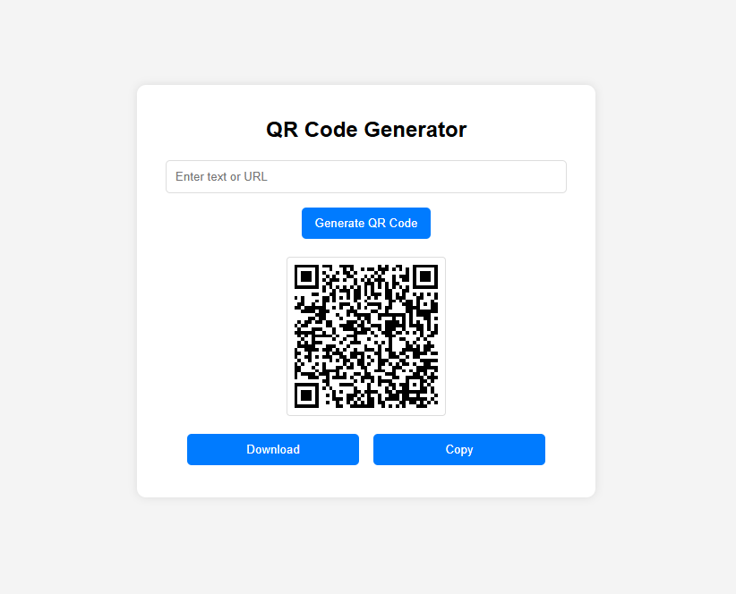

# QR Code Generator

Make QR codes for links, Wi-Fi, email, calls and SMS, add your logo, and download PNG or SVG. Everything runs in the browser, no login.

## Demo

Check out the live demo: [QR Code Generator](https://msilabs.github.io/qr-code-generator/)

## Screenshots



## Features

- **Live preview:** the code updates as you type, no button to press.
- **Content types:** URL, plain text, Wi-Fi login, email, phone call and SMS.
- **Styling:** color presets or any foreground/background color, square, rounded or dot modules, error correction level and quiet zone.
- **Logo:** upload an image to sit in the middle inside a rounded frame. Error correction switches to level H so the code still scans.
- **Export:** PNG at 512, 1024 or 2048 px, print-ready SVG, or copy the image to the clipboard.
- **Private:** everything runs in the browser. Style settings are kept in `localStorage`; Wi-Fi passwords are never saved.
- **Light and dark theme**, responsive on phones and desktops.
- **Free & Open Source:** Open for everyone to use and contribute.

## Prerequisites

To run this project, ensure you have:
- A modern web browser (e.g., Chrome, Firefox, Edge)

## Development

Built with [Alo](https://github.com/msilabs/alo). Node.js 22 or newer is needed.

```bash
npm install
npm run dev     # http://localhost:3000
npm run build   # site in dist/
```

For a sub-path such as GitHub Pages: `node alo build --base /qr-code-generator/`

```
pages/page.alo           page markup
components/SiteHeader.alo header with GitHub star button and theme toggle
components/SiteFooter.alo footer
global/style.css         all styles
global/01-qrcode.min.js  QR encoder (QRCode.js)
global/10-app.js         form, drawing and export
```

## Deploy

The GitHub Actions workflow in `.github/workflows/pages.yml` builds the site and publishes `dist/`. In the repository settings, set Pages "Source" to "GitHub Actions".

## License

[MIT](LICENSE) © msilabs
